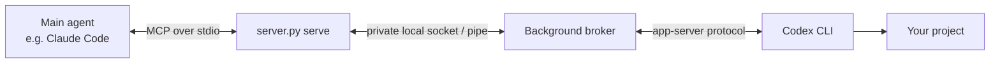

# Codex MCP

English | [简体中文](README.zh-CN.md)

**Let Claude Code (or another compatible MCP client) hand coding work to your local OpenAI Codex CLI, and keep a two-way conversation with it.**

Codex MCP is a small local MCP server. It turns the Codex CLI on your computer into a persistent coding subagent for your main AI agent:

- **Persistent conversations.** Start a task, send follow-ups, steer or interrupt it, and resume it after a restart.
- **Two-way communication.** Codex can ask the main agent questions (`ask_parent`), and the main agent answers them.
- **Safe approvals.** Nothing is approved silently. Approvals go to you, or to Codex's own automatic reviewer if you choose *Approve for me*.
- **Project-scoped sandbox.** Codex's commands can change files only in the task's project folder, and they have no network access unless you approve it. Outside the project they can read only what programs need to run. See [security](docs/security.md#project-boundary-and-sandbox).
- **Native Codex features.** Subagents, plan mode, code review, forks, queues, history and more: 34 tools in total.
- **Parallel work and limits.** Optional Git worktrees give parallel tasks their own checkout and hand back a reviewable patch; small plans start dependent steps in order; family budgets cap turns, time, tokens and stored output.
- **No extra dependencies.** Uses only the Python standard library. Works on Windows, macOS and Linux, using local pipes and sockets only (never a network port).

## Contents

- [Requirements](#requirements)
- [Installation](#installation)
- [Your first task](#your-first-task)
- [Approvals](#approvals)
- [Updating and uninstalling](#updating-and-uninstalling)
- [Troubleshooting](#troubleshooting)
- [How it works](#how-it-works)
- [Documentation](#documentation)
- [Development](#development)

## Requirements

| You need | Version | Check with |
|---|---|---|
| Python | 3.11 or newer | `python3 --version` (Windows: `py -3 --version`) |
| OpenAI Codex CLI | 0.167.0 or newer | `codex --version` |
| A Codex sign-in | ChatGPT account or API key | `codex login status` |
| An MCP client | Claude Code, Claude Desktop, or [another stdio client](docs/installation.md#other-mcp-clients) | |

Codex's own sandbox must work on your computer. The bridge never turns it off. On Windows, Codex's legacy `unelevated` sandbox is not supported; use the sandbox mode Codex sets up by default (see [installation details](docs/installation.md#windows-notes)).

## Installation

The steps below use Claude Code. For other clients, see [Step 5](#step-5-connect-your-mcp-client) and [docs/installation.md](docs/installation.md).

### Step 1: Install Python

- **Windows:** Install Python 3.11+ from [python.org](https://www.python.org/downloads/). In the installer, tick **Add python.exe to PATH**. This also installs the `py` launcher used below.
- **macOS:** `brew install python`, or use the installer from python.org.
- **Linux:** Use your distribution's package, for example `sudo apt install python3`.

### Step 2: Install and sign in to Codex

```bash
npm install -g @openai/codex
codex login
```

Any official installation method works. See [OpenAI's Codex CLI guide](https://developers.openai.com/codex/cli). Then check:

```bash
codex --version
codex login status
```

The version must be **0.167.0 or newer**. Run `codex update` to upgrade an older installation.

### Step 3: Download Codex MCP

Get the code from the [codex-mcp repository](https://github.com/houyhlouis/codex-mcp) and keep the folder in a permanent location (for example `~/tools/codex-mcp` or `C:\Tools\codex-mcp`), because your MCP client runs the server from there. The repository is public, so you don't need a GitHub account.

- **Git:**

  ```bash
  git clone https://github.com/houyhlouis/codex-mcp.git
  cd codex-mcp
  ```

- **GitHub Desktop:** Choose **File → Clone repository**, open the **URL** tab, enter `https://github.com/houyhlouis/codex-mcp`, choose a local path, and click **Clone**.
- **ZIP:** On the [latest release](https://github.com/houyhlouis/codex-mcp/releases/latest) page, download **Source code (zip)** and extract it. Rename the extracted folder to `codex-mcp`.

Nothing needs to be installed after downloading: the server runs straight from this folder. If you would rather have a `codex-local-mcp` command, see [installing as a Python package](docs/installation.md#installing-as-a-python-package-optional).

### Step 4: Check that it works

Run these commands in the `codex-mcp` folder.

macOS / Linux:

```bash
python3 server.py --version
python3 server.py status
```

Windows (PowerShell):

```powershell
py -3 server.py --version
py -3 server.py status
```

`status` starts the background broker and Codex, then prints JSON that should include `"signed_in": true`. It does not run a model or use any quota. The broker keeps running in the background and is started again automatically when it is needed.

### Step 5: Connect your MCP client

**Claude Code.** Run this inside the `codex-mcp` folder.

macOS / Linux:

```bash
claude mcp add --transport stdio --scope user codex -- python3 "$PWD/server.py" serve
```

Windows (PowerShell):

```powershell
claude mcp add --transport stdio --scope user codex -- py -3 "$PWD\server.py" serve
```

`--scope user` makes the server available in all your projects. Leave it out to add it to the current project only. Check the connection with `claude mcp list`, or type `/mcp` inside Claude Code. `codex` should show as connected.

**Claude Desktop and other clients.** Add this to the client's MCP configuration file (for Claude Desktop: **Settings → Developer → Edit Config**), then restart the client:

```json
{
  "mcpServers": {
    "codex": {
      "command": "python3",
      "args": ["/absolute/path/to/codex-mcp/server.py", "serve"]
    }
  }
}
```

On Windows use `"command": "py"` and `"args": ["-3", "C:\\Tools\\codex-mcp\\server.py", "serve"]`. Ready-made files: [examples/mcp.json](examples/mcp.json) and [examples/mcp.windows.json](examples/mcp.windows.json).

### Step 6 (optional): Teach your agent the workflow

Copy [examples/CLAUDE.md](examples/CLAUDE.md) into your project's `CLAUDE.md` (or your agent's instructions file). It explains how to poll for progress, answer questions and treat approvals.

No configuration file is needed. Optional settings, such as a custom Codex path or concurrency limit, are described in [docs/configuration.md](docs/configuration.md).

## Your first task

Ask your main agent in plain language:

```text
Use Codex in this project to find out why the tests fail and fix them.
Keep me updated and answer any questions it asks.
```

```text
Create a new project folder ~/projects/todo-cli and ask Codex to build a small
command-line to-do app with tests. Use "Approve for me" for this task.
```

```text
Continue the same Codex conversation: add a --json flag and run the tests again.
```

Behind the scenes, the main agent selects a project with `codex_projects`, starts work with `codex_start`, and polls `codex_events` until the turn finishes. It answers Codex's questions with `codex_respond` and reads the result with `codex_get`. See the [usage guide](docs/usage.md) for the full workflow and more examples.

## Approvals

Codex asks for approval before actions outside its sandbox, such as running a command that needs network access. You choose who decides for each task with `approval_mode`:

| Mode | Who decides |
|---|---|
| `inherit` (default) | Whatever your Codex configuration already uses |
| `ask` | You. The request is shown as a prompt in your MCP client, or you review it in a terminal |
| `approve_for_me` | Codex's built-in automatic reviewer. It can approve or deny; the sandbox stays on |

The main agent can always *deny* a request, but it cannot *approve* one on your behalf unless you explicitly enable `approval_relay` in the [configuration](docs/configuration.md). If your client cannot show prompts, review the request in a terminal:

```bash
python3 server.py review REQUEST_ID
```

## Updating and uninstalling

**Update:**

```bash
cd codex-mcp
python3 server.py stop
git pull
```

Then restart your MCP client. (Windows: `py -3 server.py stop`.) Always stop the broker before you update, so that the old broker never loads a file from the new version. Otherwise the client also reports that a broker from a different version is still running. Stop it when no task is working: a task that is interrupted by the stop keeps its project reserved until you call `codex_resume` for it.

If you installed from a ZIP, run `python3 server.py stop` first, then replace the folder with the new **Source code (zip)** from [Releases](https://github.com/houyhlouis/codex-mcp/releases).

**Uninstall:**

1. `python3 server.py stop`
2. `claude mcp remove codex --scope user` (or remove the entry from your client's configuration)
3. Delete the `codex-mcp` folder.
4. Optionally delete the saved task history: `~/.local/state/codex-mcp` on macOS/Linux, `%LOCALAPPDATA%\CodexMCP` on Windows.

## Troubleshooting

| Problem | What to do |
|---|---|
| Anything unclear | Run `python3 server.py doctor`. It checks the installation without starting anything or using a model, and suggests a next step for each problem. See [troubleshooting](docs/troubleshooting.md#run-the-doctor-first). |
| `Codex executable not found` | Make sure `codex --version` works in a new terminal, or set `codex_binary` to its full path in a [config file](docs/configuration.md). |
| `codex` does not appear in `/mcp` | Check the path in your client's configuration and run the same command by hand, for example `python3 /path/to/server.py status`. |
| A broker from a different version or configuration is running | Run `python3 server.py stop` (with the same `--config` if you use one), then retry. |
| A task is stuck in `waiting` | It is waiting for an answer or approval. Ask the main agent to list pending requests, or run `server.py review REQUEST_ID`. |
| Something else | See [docs/troubleshooting.md](docs/troubleshooting.md). The private log is `broker.log` in the state folder. |

## How it works



The MCP server that your client starts is a thin adapter. A background *broker* owns the Codex connection, stores tasks and events in a private SQLite database, and keeps running when the client disconnects. A reconnecting client can catch up from where it left off. See [architecture](docs/architecture.md) and [security](docs/security.md).

The sandbox applies to the commands Codex runs, not to Codex itself: the Codex process still uses your sign-in and the network to reach the model. [Security](docs/security.md#project-boundary-and-sandbox) lists exactly what commands can read and change.

## Documentation

| Guide | What it covers |
|---|---|
| [Installation details](docs/installation.md) | Other MCP clients, package install, Windows notes, running the broker manually |
| [Usage guide](docs/usage.md) | The task workflow, approvals, subagents, plan mode, forks, queues, recovery |
| [Tool reference](docs/tools.md) | All 34 tools, their arguments, task states and response formats |
| [Configuration](docs/configuration.md) | Optional settings file |
| [Troubleshooting](docs/troubleshooting.md) | Common errors and how to fix them |
| [Security](docs/security.md) | Trust model, sandbox, approvals and stored data |
| [Architecture](docs/architecture.md) | Components, message flow and delivery guarantees |
| [Limitations](docs/limitations.md) | What is intentionally not supported, and workarounds |
| [Development](docs/development.md) | Tests, CI, live checks and release packaging |
| [Changelog](CHANGELOG.md) | Release notes |

## Development

```bash
python3 -m unittest discover -v
```

The offline suite uses a simulated Codex process and uses no model quota. [CI](https://github.com/houyhlouis/codex-mcp/actions/workflows/tests.yml) runs it on Windows, macOS and Linux with Python 3.11 and 3.14 after every push. See [docs/development.md](docs/development.md) and [CONTRIBUTING.md](CONTRIBUTING.md).

## License

[MIT](LICENSE)
