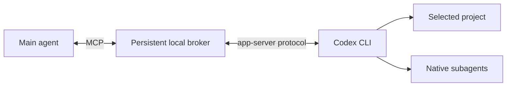

# Codex MCP

English | [简体中文](README.zh-CN.md)

**Give your main agent a Codex coding subagent that can ask questions, accept follow-ups, and keep working across reconnects.**

Codex MCP connects Claude Code and other MCP clients to your installed Codex CLI. It supports persistent conversations, native Codex subagents, and **Approve for me**, with 32 tools for the coding workflow.

## Quick start

You need **Python 3.11+**, **Codex CLI 0.167.0+**, and a working native Codex login. Run `codex login` if you have not signed in. Use the same local account for the main agent, bridge and Codex.

### 1. Connect Claude Code

From this source directory:

**macOS / Linux**

```bash
claude mcp add --transport stdio codex -- python3 "$PWD/server.py" serve
```

**Windows PowerShell**

```powershell
claude mcp add --transport stdio codex -- py -3 "$PWD\server.py" serve
```

No workspace configuration is needed. The main agent chooses or creates the directory for each project.

### 2. Start using it

Ask your main agent:

```text
Use Codex in this project to review my changes and fix the failing tests.
Keep me updated and answer any task-context questions it asks.
```

```text
Create a project directory for a small command-line app, then ask Codex
to implement it and add tests. Use Approve for me for this task.
```

Check `/mcp` in Claude Code to confirm the connection. Other clients can use the [stdio configuration examples](examples/mcp.json) and [Windows example](examples/mcp.windows.json).

## Features

- **Persistent conversations** — continue, steer or interrupt work without losing the thread.
- **Two-way communication** — Codex can call `ask_parent`; the main agent answers through MCP.
- **Native subagents** — delegate through Codex and collect child progress, results and approval requests.
- **Native automatic review** — select `approve_for_me` while keeping Codex's permission checks.
- **Session controls** — review, fork, rename, queue, compact, archive and restore conversations.
- **Reliable progress retrieval** — save task IDs and event cursors, then catch up after reconnecting.

## Examples

**Continue a task**

```text
Continue the same Codex conversation. Implement the proposed fix,
run the relevant tests, and summarize the changed files.
```

**Use native subagents**

```text
Ask Codex to delegate parser analysis and test analysis to two subagents.
Wait for their findings before editing files.
```

**Review before implementation**

```text
Switch Codex to plan mode and propose the migration steps.
After I approve the plan, continue in implementation mode.
```

For explicit calls, the main agent can create a directory with `codex_projects`, then pass the returned `project_id` to `codex_start`. It can also supply an existing absolute `workdir` directly. See [workflow examples](examples/native-controls.md).

## Common tools

| Purpose | Tools |
|---|---|
| Projects and models | `codex_projects`, `codex_models` |
| Start and continue | `codex_start`, `codex_send`, `codex_resume` |
| Progress and results | `codex_events`, `codex_get`, `codex_list` |
| Subagents | `codex_delegate`, `codex_subagents` |
| Questions and approvals | `codex_requests`, `codex_respond`, `codex_review_request` |
| Task controls | `codex_settings`, `codex_interrupt`, `codex_queue` |
| Review and history | `codex_review`, `codex_diff`, `codex_fork`, `codex_compact` |

[Full reference for all 32 tools →](docs/tools.md)

## How it works



The main agent starts work and polls `codex_events`. Questions and approvals come back with request IDs; replies return to the waiting Codex call. The broker keeps running if the client disconnects and stores events locally for later retrieval.

Each task is scoped to the directory selected by the main agent. Local communication uses private Windows named pipes or Unix sockets. Codex retains its native authentication, sandbox and account limits. See [architecture](docs/architecture.md) and the [security model](docs/security.md).

## Approvals

Set `approval_mode` on `codex_start`, or change it with `codex_settings`:

- `ask` — present requests for human review.
- `approve_for_me` — let Codex's native reviewer evaluate eligible requests.
- `inherit` — use the existing native reviewer setting; the default for new tasks.

If the client cannot display a human prompt, review it in a terminal with `python server.py review REQUEST_ID`. Automatic review does not require enabling the separate `approval_relay` option.

## Configuration and compatibility

The default setup needs no config file. Optional [server settings](config.example.toml) cover the Codex executable, private state location and concurrency; projects are selected through tools. See [configuration](docs/configuration.md) for details.

Native Windows, macOS and Linux adapters are included. Codex must have a working native sandbox on the chosen OS; the bridge does not substitute full access. This development session validated Linux. Platform-specific test coverage and remaining limits are recorded in [validation](docs/validation.md) and [platform notes](docs/platforms.md).

## Development

```bash
python -m unittest discover -v
```

The offline suite uses a simulated Codex backend and consumes no model usage. The CI matrix targets Windows, macOS and Linux. See [CONTRIBUTING.md](CONTRIBUTING.md) for optional client and live checks.

## Documentation

- [Tool reference](docs/tools.md) and [workflow examples](examples/native-controls.md)
- [Architecture and messaging](docs/architecture.md)
- [Configuration](docs/configuration.md) and [troubleshooting](docs/troubleshooting.md)
- [Terminal feature coverage](docs/terminal-parity.md) and [known limitations](docs/limitations.md)
- [Security](docs/security.md) and [validation](docs/validation.md)

## License

[MIT](LICENSE)
