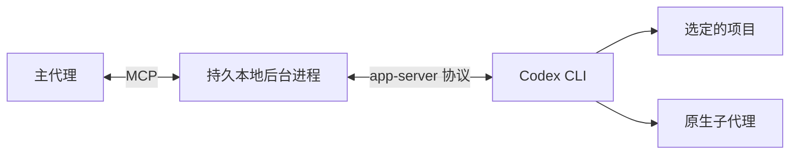

# Codex MCP

[English](README.md) | 简体中文

**让主代理拥有一个能提问、能继续对话，并在重连后继续协作的 Codex 编程子代理。**

Codex MCP 将 Claude Code 等 MCP 客户端连接到本机安装的 Codex CLI，提供持久会话、原生子代理、**Approve for me** 自动审核，以及覆盖编程工作流的 32 个工具。

## 快速开始

需要 **Python 3.11+**、**Codex CLI 0.167.0+**，以及可用的原生 Codex 登录。尚未登录时运行 `codex login`。主代理、桥接服务和 Codex 应使用同一个本地账户。

### 1. 连接 Claude Code

在源码目录中执行：

**macOS / Linux**

```bash
claude mcp add --transport stdio codex -- python3 "$PWD/server.py" serve
```

**Windows PowerShell**

```powershell
claude mcp add --transport stdio codex -- py -3 "$PWD\server.py" serve
```

无需配置工作区列表。每个项目的目录由主代理选择或创建。

### 2. 开始使用

可以直接对主代理说：

```text
让 Codex 在当前项目中审查我的改动，修复失败的测试。
持续跟踪进度，并回答它提出的任务上下文问题。
```

```text
创建一个用于小型命令行应用的项目目录，让 Codex 完成实现并添加测试。
这个任务使用 Approve for me。
```

在 Claude Code 的 `/mcp` 中检查连接。其他客户端可参考 [stdio 配置示例](examples/mcp.json)和 [Windows 配置示例](examples/mcp.windows.json)。

## 主要功能

- **持久会话**：继续、引导或中断工作，保留已有对话上下文。
- **双向沟通**：Codex 调用 `ask_parent` 提问，主代理通过 MCP 回答。
- **原生子代理**：让 Codex 委派任务，汇总子代理的进度、结果与审批请求。
- **原生自动审核**：选择 `approve_for_me`，同时保留 Codex 的权限检查。
- **会话控制**：审查、分叉、重命名、排队、压缩、归档和恢复。
- **进度补读**：保存任务 ID 与事件游标，断开连接后仍可获取后续记录。

## 使用示例

**继续已有任务**

```text
继续刚才的 Codex 会话，落实提出的修复方案，运行相关测试，
最后汇总修改的文件和测试结果。
```

**使用原生子代理**

```text
让 Codex 分别委派两个子代理分析解析器和测试，
等它们汇报之后再开始修改文件。
```

**先规划，再实现**

```text
切换到 Codex 的计划模式，先给出迁移步骤。
等我确认后，再切回实现模式继续。
```

主代理也可以先用 `codex_projects` 创建目录，再将返回的 `project_id` 交给 `codex_start`；或者直接提供已有目录的绝对路径 `workdir`。更多调用方式见 [工作流示例](examples/native-controls.md)。

## 常用工具

| 用途 | 工具 |
|---|---|
| 项目与模型 | `codex_projects`、`codex_models` |
| 启动与继续 | `codex_start`、`codex_send`、`codex_resume` |
| 进度与结果 | `codex_events`、`codex_get`、`codex_list` |
| 子代理 | `codex_delegate`、`codex_subagents` |
| 问题与审批 | `codex_requests`、`codex_respond`、`codex_review_request` |
| 任务控制 | `codex_settings`、`codex_interrupt`、`codex_queue` |
| 审查与历史 | `codex_review`、`codex_diff`、`codex_fork`、`codex_compact` |

[查看全部 32 个工具的参数说明 →](docs/tools.zh-CN.md)

## 工作原理



主代理启动任务并轮询 `codex_events`。问题和审批请求带有独立 ID，答案会返回对应的 Codex 工具调用。客户端断开后，后台进程仍可运行，事件保存在本地，供重连后补读。

每个任务的访问范围由主代理选定的目录确定。本地通信使用 Windows 私有命名管道或 Unix 套接字。Codex 保留原生认证、沙箱和账户限制。详见 [架构说明](docs/architecture.zh-CN.md)与[安全模型](docs/security.zh-CN.md)。

## 审批方式

在 `codex_start` 中设置 `approval_mode`，或通过 `codex_settings` 调整：

- `ask`：需要决定的请求进入人工审核流程。
- `approve_for_me`：由 Codex 原生审核器处理适用的请求。
- `inherit`：沿用原生审核器设置，是新任务的默认值。

如果客户端无法显示人工确认界面，可在终端运行 `python server.py review REQUEST_ID`。原生自动审核不需要开启独立的 `approval_relay` 配置。

## 配置与兼容性

默认使用不需要配置文件。可选的[服务设置](config.example.toml)用于指定 Codex 可执行文件、私有状态目录或并发数；工作目录始终通过工具选择。详见 [配置说明](docs/configuration.zh-CN.md)。

项目包含 Windows、macOS 和 Linux 的原生适配。所用系统必须能够运行 Codex 的正常沙箱，服务不会自动切换成完全访问模式。本次开发环境实测的是 Linux；各平台测试范围和限制见 [验证记录](docs/validation.zh-CN.md)与[平台说明](docs/platforms.zh-CN.md)。

## 开发

```bash
python -m unittest discover -v
```

离线测试使用模拟 Codex，不消耗模型额度。CI 测试矩阵覆盖 Windows、macOS 和 Linux。其他客户端检查与真实 Codex 测试见 [CONTRIBUTING.md](CONTRIBUTING.md)。

## 文档

- [工具参考](docs/tools.zh-CN.md)与[工作流示例](examples/native-controls.md)
- [架构与消息机制](docs/architecture.zh-CN.md)
- [配置](docs/configuration.zh-CN.md)与[故障排查](docs/troubleshooting.zh-CN.md)
- [终端功能对照](docs/terminal-parity.zh-CN.md)与[已知限制](docs/limitations.zh-CN.md)
- [安全模型](docs/security.zh-CN.md)与[验证记录](docs/validation.zh-CN.md)

## 许可证

[MIT](LICENSE)
