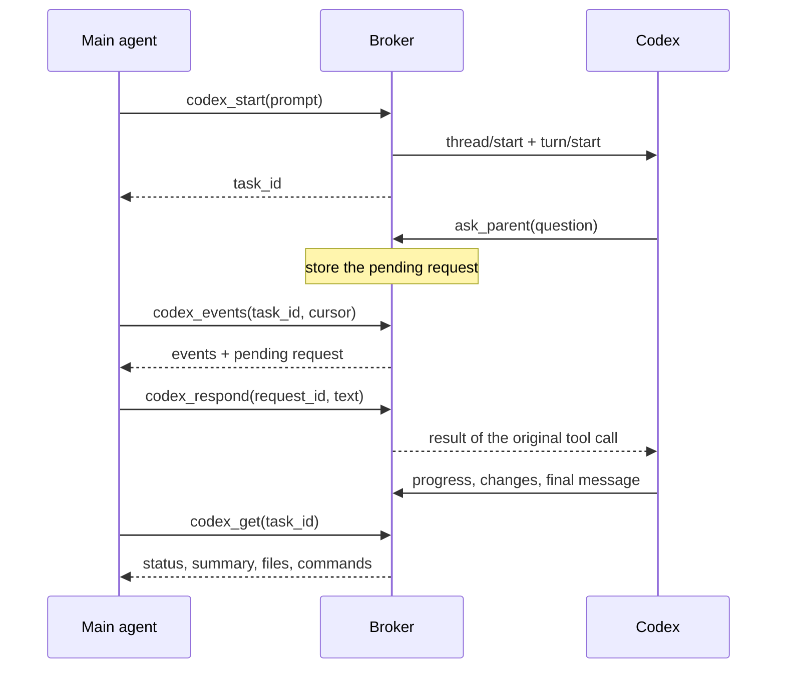

# Architecture

[Back to README](../README.md)

## Components

```text
MCP client (e.g. Claude Code)
    │  MCP JSON-RPC over stdin/stdout
    ▼
server.py serve            ── mcp.py, tools.py: handshake, tool schemas, validation, human prompts
    │  one JSON request per connection over a private Unix socket / Windows named pipe
    ▼
background broker          ── broker.py: lifecycle, locking, local IPC
    │                         service.py, extensions.py: tasks, approvals, subagents, controls
    │                         store.py: SQLite tasks, requests, operation keys, event journal
    │  JSON-RPC over the child's stdin/stdout
    ▼
codex app-server           ── backend.py: launches Codex, sends requests, dispatches events in order
    │  native sign-in, sandbox, approvals, tools
    ▼
your project / OpenAI model service
```

| Module | Responsibility |
|---|---|
| [`cli.py`](../codex_local_mcp/cli.py) | Command-line entry point (`serve`, `start`, `stop`, `status`, `review`, `call`) |
| [`mcp.py`](../codex_local_mcp/mcp.py) | MCP stdio server, protocol negotiation, progress notifications, form elicitation |
| [`tools.py`](../codex_local_mcp/tools.py) | The 32 tool schemas, the argument validator and the dispatch allowlist |
| [`broker.py`](../codex_local_mcp/broker.py) | Starting, finding and stopping the broker; the private IPC transport |
| [`service.py`](../codex_local_mcp/service.py) | Task lifecycle, approval routing, event replay, recovery |
| [`extensions.py`](../codex_local_mcp/extensions.py) | Settings, subagents, fork/review/queue/goal and other native controls |
| [`backend.py`](../codex_local_mcp/backend.py) | The Codex app-server process and its permission profiles |
| [`store.py`](../codex_local_mcp/store.py) | SQLite persistence |
| [`security.py`](../codex_local_mcp/security.py) | Path checks, private files and folders, redaction |
| [`config.py`](../codex_local_mcp/config.py) | Optional settings file |
| [`platforms.py`](../codex_local_mcp/platforms.py), [`windows.py`](../codex_local_mcp/windows.py) | OS-specific locking, process, stdio and Win32 named-pipe/ACL code |

## Lifecycle

- The MCP client starts `server.py serve`. The handshake and `tools/list` work without starting anything else.
- The first real tool call starts the broker, or connects to the one already running. A startup lock prevents two clients from starting two brokers. The broker runs detached, so it survives the client.
- The broker starts `codex app-server` on demand. One app-server hosts all conversations.
- `server.py stop` asks the broker to shut down and waits until the process has exited. On shutdown, the broker stops Codex.
- The broker records a fingerprint of the server version and settings. A client with a different fingerprint is refused, so an updated server never silently talks to an old broker.

## A conversation, step by step



`thread/start` registers `ask_parent` as a dynamic tool, adds short subagent instructions, and selects the restricted permission profile. When Codex calls `ask_parent` or asks for an approval, the broker keeps Codex's original request ID and gives the MCP client its own pending-request ID. The answer becomes the result of that exact call, so Codex continues within the same turn.

The server never calls the main agent's model itself. The main agent has to poll `codex_events` (or use `wait_seconds`) to see progress. Progress notifications and form prompts are used when the client supports them, but nothing depends on them.

## IDs and delivery guarantees

| ID | Meaning |
|---|---|
| `task_id` | The bridge's handle for a conversation (including verified subagents and imported sessions) |
| `thread_id` | Codex's own conversation ID |
| `turn_id` | One round of work within a conversation |
| operation `request_id` | Duplicate-protection key for an action that changes something |
| pending `request_id` | Handle for one live question or approval |
| event `cursor` | Exclusive position in this broker's event journal |
| history `cursor` | Opaque page token from Codex's history APIs (not an event cursor) |

- Task state and received events are committed to SQLite together.
- A repeated operation key returns the saved acknowledgement. An operation whose outcome is unknown is marked `uncertain` and never replayed automatically.
- After a client reconnect, replay events from the saved cursor; nothing is lost.
- After a broker or Codex restart, active tasks become `needs_resume` and pending requests expire. `codex_resume` reloads the conversation and reconciles its latest turn from Codex's history. Events that Codex streamed but the broker never received cannot be reconstructed; Codex's persisted history can be paged with `codex_history`.
- Reading Codex's output and processing events are separate tasks. Handling a subagent event can therefore query Codex without blocking responses.

## Native subagents

`codex_delegate` asks the parent conversation to use Codex's own subagent tools. When a new child appears (through an event or `codex_subagents`), the broker checks that its parent chain reaches a task it owns and that its directory is inside the parent's project. It then resumes the child with the same permission profile and verifies Codex's acknowledgement. The child gets its own `task_id`, and its events and requests are tagged with parent and root IDs. After a backend restart, known children are checked and subscribed again.

## Why the Codex app-server

The app-server protocol is the only Codex interface with typed, two-way approvals and questions, persistent threads, history paging and native subagent metadata. Alternatives were evaluated:

| Alternative | Why it was not used |
|---|---|
| `codex exec --json` / `exec resume` | Good for batch jobs, but has no interactive approval channel |
| Official Codex SDKs | Viable. The TypeScript SDK wraps `codex exec`; using the protocol directly avoids a second runtime and keeps request routing explicit |
| Sharing the user's existing app-server daemon | Would take ownership of a daemon the user may rely on and expose its wider thread list |
| Driving the terminal UI | Screen scraping and synthetic keystrokes lose typed request IDs and decisions |
| The old `codex mcp-server` | Removed from current Codex versions |

Request and response shapes are checked against the schema generated by the installed Codex (`scripts/check_protocol.py`).
