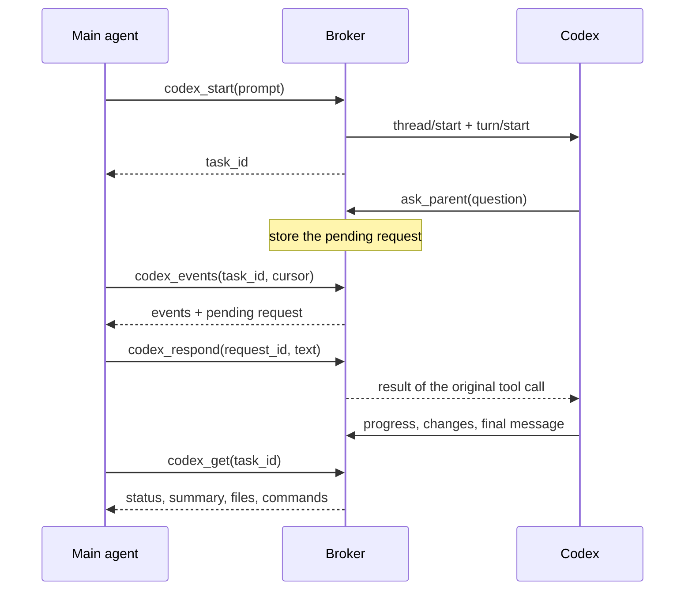

# Architecture

[Back to README](../README.md)

## Components

```text
MCP client (e.g. Claude Code)
    │  MCP JSON-RPC over stdin/stdout
    ▼
server.py serve            ── mcp.py, tools.py: handshake, tool schemas, validation, human prompts
    │  one JSON request per connection over a private Unix socket / Windows named pipe
    ▼
background broker          ── broker.py: lifecycle, locking, local IPC
    │                         service.py, extensions.py: tasks, approvals, subagents, controls
    │                         store.py: SQLite tasks, requests, operation keys, event journal
    │  JSON-RPC over the child's stdin/stdout
    ▼
codex app-server           ── backend.py: launches Codex, sends requests, dispatches events in order
    │  native sign-in, sandbox, approvals, tools
    ▼
your project / OpenAI model service
```

| Module | Responsibility |
|---|---|
| [`cli.py`](../codex_local_mcp/cli.py) | Command-line entry point (`serve`, `start`, `stop`, `status`, `doctor`, `backup`, `prune`, `incident-export`, `review`, `call`) |
| [`diagnostics.py`](../codex_local_mcp/diagnostics.py) | The checks behind `doctor`. Read-only by default |
| [`mcp.py`](../codex_local_mcp/mcp.py) | MCP stdio server, protocol negotiation, progress notifications, form elicitation |
| [`mcp_modern.py`](../codex_local_mcp/mcp_modern.py), [`protocol_tasks.py`](../codex_local_mcp/protocol_tasks.py) | The separate adapter for MCP 2026-07-28: per-request capabilities, review forms and the Tasks extension |
| [`tools.py`](../codex_local_mcp/tools.py) | The 34 tool schemas, the argument validator and the dispatch allowlist |
| [`broker.py`](../codex_local_mcp/broker.py) | Starting, finding and stopping the broker; the private IPC transport |
| [`service.py`](../codex_local_mcp/service.py) | Task operations, approval routing, event replay, recovery |
| [`lifecycle.py`](../codex_local_mcp/lifecycle.py) | Task states and turn transitions. The only place that changes a task's status |
| [`extensions.py`](../codex_local_mcp/extensions.py) | Settings, subagents, fork/review/queue/goal and other native controls |
| [`backend.py`](../codex_local_mcp/backend.py) | The Codex app-server process, its permission profiles and the bounded event queue |
| [`contract.py`](../codex_local_mcp/contract.py) | Supported Codex and MCP versions, and which Codex methods are required or optional |
| [`store.py`](../codex_local_mcp/store.py) | SQLite persistence, schema versions and upgrades |
| [`authority.py`](../codex_local_mcp/authority.py) | Explains what a request would allow, and holds the one rule for who may accept it |
| [`decisions.py`](../codex_local_mcp/decisions.py), [`guidance_retention.py`](../codex_local_mcp/guidance_retention.py) | Structured questions and delegation contracts, and how long their records are kept |
| [`reconciliation.py`](../codex_local_mcp/reconciliation.py) | The report on what was requested, what happened and what is unknown after an interruption |
| [`outcomes.py`](../codex_local_mcp/outcomes.py), [`supervision.py`](../codex_local_mcp/supervision.py) | The outcome view for watching several tasks, and the small indexed tables behind it and behind decision receipts |
| [`evidence.py`](../codex_local_mcp/evidence.py) | Turn results: what Codex reported for a turn, with sources, and the artifacts that hold large content |
| [`incidents.py`](../codex_local_mcp/incidents.py) | `incident-export`: the structure of a task without its content |
| [`retention.py`](../codex_local_mcp/retention.py) | The operator's `backup` and `prune` commands: plans, protected data, removal |
| [`processes.py`](../codex_local_mcp/processes.py) | What is remembered about work that was running when contact with Codex was lost, and the scan of an old journal for unfinished commands |
| [`plans.py`](../codex_local_mcp/plans.py), [`execution_plans.py`](../codex_local_mcp/execution_plans.py) | Plans: checking a plan and deciding which steps may run (no side effects), and storing and starting the steps through the normal operations |
| [`resources.py`](../codex_local_mcp/resources.py) | Family usage accounting and budgets: counters, admission reservations, cooperative stops |
| [`worktrees.py`](../codex_local_mcp/worktrees.py), [`managed_worktrees.py`](../codex_local_mcp/managed_worktrees.py) | The restricted Git helper that prepares, hands off and removes worktrees, and its connection to projects, reservations and artifacts |
| [`procscan.py`](../codex_local_mcp/procscan.py), [`workspace_processes.py`](../codex_local_mcp/workspace_processes.py) | Linux only: finds leftover Codex sandbox processes of a project by reading `/proc`, and holds the project while any exist. Never signals a process |
| [`security.py`](../codex_local_mcp/security.py) | Path checks, private files and folders, redaction |
| [`config.py`](../codex_local_mcp/config.py) | Optional settings file |
| [`platforms.py`](../codex_local_mcp/platforms.py), [`windows.py`](../codex_local_mcp/windows.py) | OS-specific locking, process, stdio and Win32 named-pipe/ACL code |

## Lifecycle

- The MCP client starts `server.py serve`. The handshake and `tools/list` work without starting anything else.
- The first real tool call starts the broker, or connects to the one already running. A startup lock prevents two clients from starting two brokers. The broker runs detached, so it survives the client.
- The broker starts `codex app-server` on demand. One app-server hosts all conversations.
- `server.py stop` asks the broker to shut down and waits until the process has exited. On shutdown, the broker stops Codex.
- The broker records a fingerprint of the server version and settings. A client with a different fingerprint is refused, so an updated server never silently talks to an old broker.

## A conversation, step by step



`thread/start` registers `ask_parent` as a dynamic tool, adds short subagent instructions, and selects the restricted permission profile. When Codex calls `ask_parent` or asks for an approval, the broker keeps Codex's original request ID and gives the MCP client its own pending-request ID. The answer becomes the result of that exact call, so Codex continues within the same turn.

The server never calls the main agent's model itself. The main agent has to poll `codex_events` (or use `wait_seconds`) to see progress. Progress notifications and form prompts are used when the client supports them, but nothing depends on them.

## IDs and delivery guarantees

| ID | Meaning |
|---|---|
| `task_id` | The bridge's handle for a conversation (including verified subagents and imported sessions) |
| `thread_id` | Codex's own conversation ID |
| `turn_id` | One round of work within a conversation |
| operation `request_id` | Duplicate-protection key for an action that changes something |
| pending `request_id` | Handle for one live question or approval |
| event `cursor` | Exclusive position in this broker's event journal |
| history `cursor` | Opaque page token from Codex's history APIs (not an event cursor) |

- Task state and received events are committed to SQLite together.
- A repeated operation key returns the saved acknowledgement. An operation whose outcome is unknown is marked `uncertain` and never replayed automatically.
- After a client reconnect, replay events from the saved cursor; nothing is lost.
- After a broker or Codex restart, active tasks become `needs_resume` and pending requests expire. `codex_resume` reloads the conversation and reconciles its latest turn from Codex's history. Events that Codex streamed but the broker never received cannot be reconstructed; Codex's persisted history can be paged with `codex_history`.
- Reading Codex's output and processing events are separate tasks. Handling a subagent event can therefore query Codex without blocking responses.
- Changes to a task go through `lifecycle.py` and update single fields of the newest record. A slow call to Codex can therefore never write an old copy of a task over newer events. Results such as the diff carry the ID of the turn they belong to.
- A project is reserved through *workspace claims* stored in the database, not through the task status alone. A queued instruction or an active goal therefore keeps the project reserved between turns and across restarts. When a turn ends, the broker checks Codex by itself and releases the claims that Codex confirms are finished. See [Why a project stays busy](tools.md#why-a-project-stays-busy).
- Starting work takes a short global lock, only to check the limits and record the operation key. Calls to Codex then run under one lock per task family. Interrupts and answers bypass that lock, so a slow call for one project does not delay stopping another.
- Events from Codex wait in a bounded queue (1,024 events or 4 MiB). When it is full, only streamed progress deltas are dropped, and a `bridge/event_gap` marker is journaled. If the protected events alone would exceed the limit, the broker disconnects from Codex and the active tasks become `needs_resume`.
- A message from Codex that this version does not understand is contained to its own task where that is safe. A malformed request is rejected and grants nothing.
- Every tool result stays under 8 MiB. Long lists are paged and large requests are summarised, with the full content available on request.
- The database carries a schema version. An upgrade runs in one transaction after a backup has been made; if it fails, the previous state is kept.
- Each task and pending request is stored as one JSON record. The fields that are looked up often (Codex's conversation ID, parent and root task, status, project) are also stored in indexed columns, and both are written in the same transaction. Finding the task that an event belongs to is therefore one index lookup, however long the history is. A conversation ID can belong to only one task; the database enforces this.
- Large output is stored once. An artifact that holds output from the journal is a reference to the journal event, checked by hash when it is read; only file content, which is not in the journal, is stored separately. A journal event cannot be cleaned up while an artifact still refers to it.
- Cleaning up is never automatic. `prune` works on a stopped broker, from a plan that is checked again before it is applied. A removed operation result leaves a small marker behind, so its key can never run the work a second time, and a cursor into removed events gets an explicit error.
- Every answer to a request leaves a decision receipt: which request, which proposal hash, which decision, when, and through which channel. The channel is set by the trusted adapter (client prompt or terminal), never by tool arguments. A receipt is a record, not a reusable permission.
- Watching tasks does not read history. Each change to a task, request or reservation advances a per-task counter in the same transaction, and the outcome view compares counters.
- Errors carry a stable code from one table in `security.py` (`BridgeError.CODES`). The broker sends the code to the MCP adapter together with the message, so the adapter never has to interpret message text.

## Native subagents

`codex_delegate` asks the parent conversation to use Codex's own subagent tools. When a new child appears (through an event or `codex_subagents`), the broker checks that its parent chain reaches a task it owns and that its directory is inside the parent's project. It then resumes the child with the same permission profile and verifies Codex's acknowledgement. The child gets its own `task_id`, and its events and requests are tagged with parent and root IDs. After a backend restart, known children are checked and subscribed again.

## Why the Codex app-server

The app-server protocol is the only Codex interface with typed, two-way approvals and questions, persistent threads, history paging and native subagent metadata. Alternatives were evaluated:

| Alternative | Why it was not used |
|---|---|
| `codex exec --json` / `exec resume` | Good for batch jobs, but has no interactive approval channel |
| Official Codex SDKs | Viable. The TypeScript SDK wraps `codex exec`; using the protocol directly avoids a second runtime and keeps request routing explicit |
| Sharing the user's existing app-server daemon | Would take ownership of a daemon the user may rely on and expose its wider thread list |
| Driving the terminal UI | Screen scraping and synthetic keystrokes lose typed request IDs and decisions |
| The old `codex mcp-server` | Removed from current Codex versions |

Request and response shapes are checked against the schema generated by the installed Codex (`scripts/check_protocol.py`). The messages that the bridge really sends are recorded by the tests and checked the same way.
