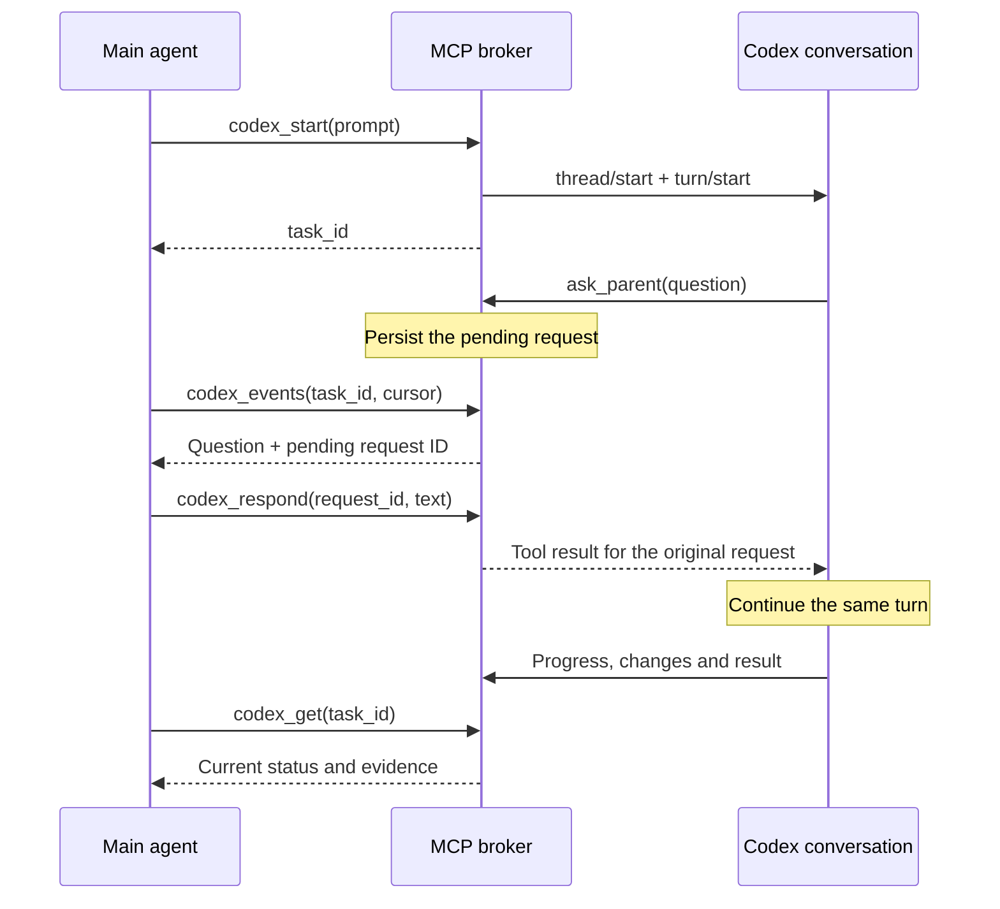

# Architecture and message flow

English | [简体中文](architecture.zh-CN.md)

[English README](../README.md) · [中文 README](../README.zh-CN.md) · [Tool reference](tools.md)

## Processes and responsibilities

| Component | Responsibility | Implementation |
|---|---|---|
| MCP adapter | Tool discovery, argument validation, stdio framing, optional human elicitation | [mcp.py](../codex_local_mcp/mcp.py), [tools.py](../codex_local_mcp/tools.py) |
| Background broker | Same-user Unix-socket/Windows-pipe IPC, process lifecycle, shared task service | [broker.py](../codex_local_mcp/broker.py) |
| Codex connection | Launch installed app-server, exchange structured requests, dispatch ordered events | [backend.py](../codex_local_mcp/backend.py) |
| Task service | Conversations, input, approvals, summaries and event replay | [service.py](../codex_local_mcp/service.py), [extensions.py](../codex_local_mcp/extensions.py) |
| Persistence | SQLite task records, requests, operation acknowledgements and journal | [store.py](../codex_local_mcp/store.py) |
| Boundaries | Operator configuration, project paths, private files and output redaction | [config.py](../codex_local_mcp/config.py), [security.py](../codex_local_mcp/security.py) |

The MCP adapter starts when the client connects. A real tool call starts or finds the detached broker; Codex starts when needed. One broker owns one app-server connection, which can host multiple native conversations. Disconnecting the adapter does not terminate the broker. Stopping the broker terminates its Codex process.

The bridge does not install a boot service, modify Codex authentication, run a network listener, or forward arbitrary internal RPC methods. Native Codex uses its existing account/provider configuration to contact the model service.

## Main agent and Codex conversation

`thread/start` registers `ask_parent` as a dynamic tool and adds instructions describing the subagent role. Codex can invoke that tool when it needs task context. The broker keeps the original native request ID and exposes a separate pending-request ID to the MCP client. A `codex_respond` answer becomes the result of that exact tool call, so Codex can continue within its existing turn.

New instructions use `turn/start`; active steering uses `turn/steer` with an expected turn ID. Ordinary progress and final answers arrive as events. The main agent must poll or wait for those events—the server does not invoke the main agent's model itself. The models keep separate conversation histories; messages, selected context and shared project files provide the connection.

## Native children

`codex_delegate` asks a Codex parent to use its native subagent tools. The bridge then discovers descendants from native events and scoped thread listing. Before subscribing it verifies the parent chain, directory and permission-profile acknowledgement. Each child gets a bridge task ID, with its parent/root IDs retained for routing.

Parent polling includes descendants by default. Children advertising `canAcceptDirectInput: false` must be controlled through the native parent. `family_status` stays active while any known family member is active, queued or awaiting recovery. Parent-turn completion alone does not establish that all delegated work finished.

Native cancellation can interrupt a child without finishing the parent's wait. In that case the main agent can explicitly interrupt the parent and send a follow-up. The bridge does not restart the denied child action or invent its final answer.

## IDs and delivery guarantees

| Value | Meaning |
|---|---|
| `task_id` | Bridge conversation handle, including verified children and explicitly imported root sessions |
| `thread_id` | Corresponding native Codex conversation ID |
| `turn_id` | A particular native round of work |
| Operation `request_id` | Duplicate-protection key for a mutating control call |
| Pending-request `request_id` | Handle used to answer a specific live question/approval |
| Event `cursor` | Exclusive replay position in this broker's journal |
| Native history cursor | Opaque pagination value from Codex history APIs; not an event cursor |

Task state and received events are committed locally. Successful duplicate operations return the saved acknowledgement; uncertain operations are not automatically replayed. After an adapter reconnect, replay from the last consumed cursor. After broker/backend failure, resume and inspect native history. Committed journal entries survive; never-received or uncommitted stream deltas cannot be reconstructed exactly.

The RPC reader and event consumer are separate so handling a child event can query native metadata without blocking incoming RPC responses. Shutdown invalidates live subscriptions and pending approval requests. Expired requests cannot be answered against a new backend generation.

## Approval and data boundaries

Task-context answers are different from permission approvals. Native **Approve for me** selects Codex's `auto_review` reviewer with `on-request` policy and the same restricted project profile. Human requests use MCP elicitation or terminal review; optional `approval_relay` delegates response submission to the main agent. None of these mechanisms is a raw shell or global policy-editing endpoint.

The local state directory retains prompts, event output, diffs and image snapshots. Common credential patterns are redacted, but arbitrary text can still contain sensitive project data. See [security](security.md) for the exact trust model and [limitations](limitations.md) for recovery/platform boundaries.

## Platform and project selection

The main agent passes an absolute workdir or creates/selects a directory through codex_projects. No workspace settings are required. The backend converts each selected directory into a native per-task permission profile. Windows uses private named pipes; macOS and Linux use identity-checked Unix sockets. See [platform notes](platforms.md).
