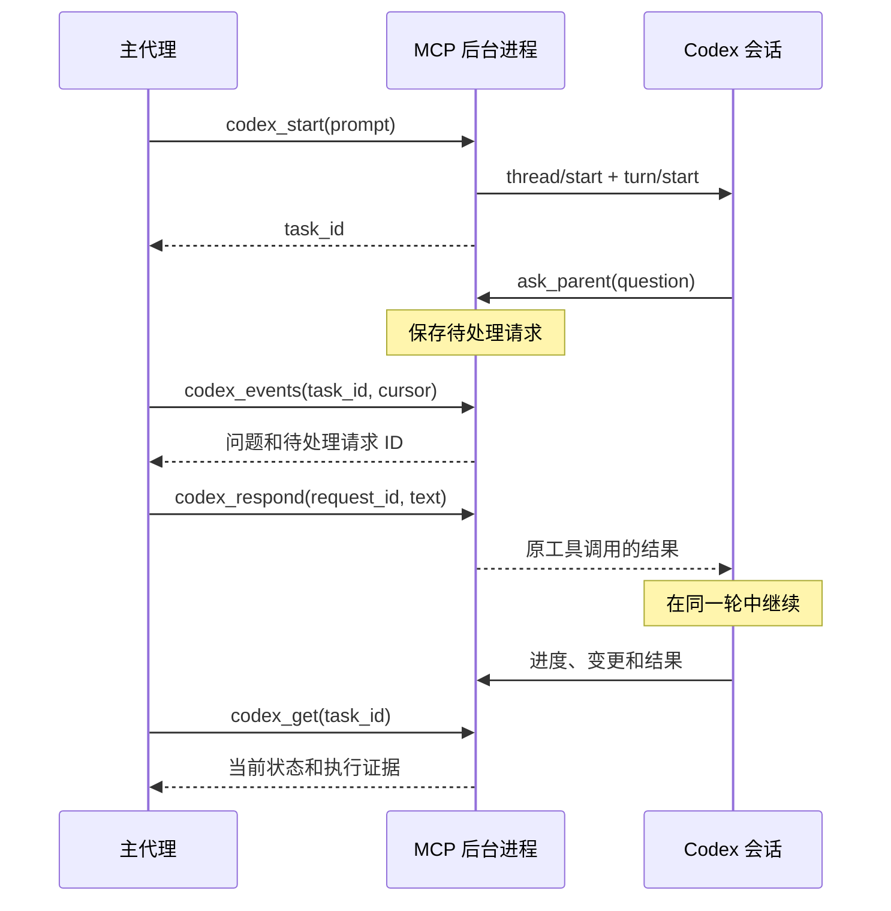

# 架构与消息流程

[English](architecture.md) | 简体中文 · [中文首页](../README.zh-CN.md) · [工具参考](tools.zh-CN.md)

## 进程及职责

| 组件 | 职责 | 实现文件 |
|---|---|---|
| MCP 适配器 | 工具发现、参数校验、stdio 消息格式，以及可选的人工确认界面 | [mcp.py](../codex_local_mcp/mcp.py)、[tools.py](../codex_local_mcp/tools.py) |
| 后台进程 | 同一用户下的 Unix 套接字/Windows 命名管道通信、进程生命周期及共享任务服务 | [broker.py](../codex_local_mcp/broker.py) |
| Codex 连接 | 启动已安装的 app-server，交换结构化请求，按顺序分发事件 | [backend.py](../codex_local_mcp/backend.py) |
| 任务服务 | 会话、输入、审批、摘要和事件重放 | [service.py](../codex_local_mcp/service.py)、[extensions.py](../codex_local_mcp/extensions.py) |
| 持久化 | SQLite 任务记录、待处理请求、操作确认结果和事件日志 | [store.py](../codex_local_mcp/store.py) |
| 访问边界 | 操作者配置、项目路径、私有文件和输出脱敏 | [config.py](../codex_local_mcp/config.py)、[security.py](../codex_local_mcp/security.py) |

客户端连接时启动 MCP 适配器。首次实际调用工具时，适配器启动或找到独立后台进程；需要 Codex 时再启动它。一个后台进程拥有一条 app-server 连接，该连接可承载多个原生会话。断开适配器不会终止后台进程；停止后台进程会终止其 Codex 进程。

桥接服务不会安装开机启动服务、修改 Codex 认证、监听网络端口，也不会透传任意内部 RPC 方法。原生 Codex 继续使用已有账户和模型提供商配置。

## 主代理与 Codex 的对话

`thread/start` 将 `ask_parent` 注册为动态工具，并附加说明子代理职责的指令。Codex 需要任务上下文时可以调用它。后台保留原生请求 ID，同时向 MCP 客户端提供独立的待处理请求 ID。`codex_respond` 的答案会作为原工具调用的结果返回，Codex 因而能够保留上下文，在同一轮中继续工作。

新指令通过 `turn/start` 进入会话；对正在运行的任务进行引导时，使用 `turn/steer` 并指定预期轮次 ID。普通进度和最终回答通过事件返回。主代理必须轮询或等待事件，服务不会自行调用主代理的模型。不同模型保留各自的会话历史，通过消息、选定的上下文和共享项目文件协作。

## 原生子代理

`codex_delegate` 请求 Codex 父代理使用自己的原生子代理工具。桥接服务通过原生事件及限定范围的会话列表发现后代，再验证父子关系链、目录和权限配置确认结果。验证通过后，子代理获得桥接任务 ID，同时保存父任务和根任务 ID 以便路由。

父任务轮询默认包含后代事件。如果子代理声明 `canAcceptDirectInput: false`，必须通过其原生父代理控制。只要已知任务组成员中还有运行、排队或等待恢复的任务，`family_status` 就保持 `active`。父代理某一轮完成，不代表所有委派工作已经结束。

取消原生子代理的请求可能中断子代理，却不结束父代理的等待。主代理可以明确中断父代理，再发送后续说明。桥接不会自动重启被拒绝的子代理操作，也不会虚构子代理的最终回答。

## ID 与交付保证

| 字段 | 含义 |
|---|---|
| `task_id` | 桥接会话标识，涵盖验证通过的子代理和明确导入的根会话 |
| `thread_id` | 对应的原生 Codex 会话 ID |
| `turn_id` | 某一轮原生工作 |
| 操作 `request_id` | 修改类控制调用的重复操作保护键 |
| 待处理请求 `request_id` | 回答某个仍然有效的问题或审批请求时使用的标识 |
| 事件 `cursor` | 后台事件日志中的排他性重放位置 |
| 原生历史游标 | Codex 历史 API 返回的不透明分页值，与事件游标不同 |

任务状态和已收到的事件会提交到本地数据库。重复的成功操作返回原始确认结果；结果不确定的操作不会自动重放。适配器重连后，从最后处理完的游标继续读取。后台或 Codex 失败后，应恢复会话并核对原生历史。已经提交的日志记录会保留；从未收到或尚未提交的流式增量无法完整重建。

RPC 响应读取和事件处理使用不同的执行路径，因此处理子代理事件时可以查询原生元数据，而不会阻塞 RPC 响应读取。关闭连接会使实时订阅和待审批请求失效，旧请求不能在新的后台实例中继续作答。

## 审批与数据边界

任务上下文回答与权限审批分开处理。原生 **Approve for me** 使用 `auto_review` 审核器、`on-request` 策略和同一受限项目配置。需要人工处理的请求通过 MCP 确认界面或终端处理；可选的 `approval_relay` 将提交响应的权限交给受信任主代理。这些路径都不提供任意 Shell 或全局策略修改能力。

私有状态目录保存提示、输出、差异及图片快照。常见凭据模式会被脱敏，但任意文本仍可能包含敏感项目数据。完整信任模型见 [安全说明](security.zh-CN.md)，恢复及平台边界见 [已知限制](limitations.zh-CN.md)。

## 平台与项目选择

主代理通过 `codex_projects` 创建/选择目录，或直接传入绝对 `workdir`；不需要工作区设置。后台将选定目录转换成每个任务的原生权限范围。Windows 使用私有命名管道，macOS 和 Linux 使用带身份校验的 Unix 套接字。详见 [平台说明](platforms.zh-CN.md)。
